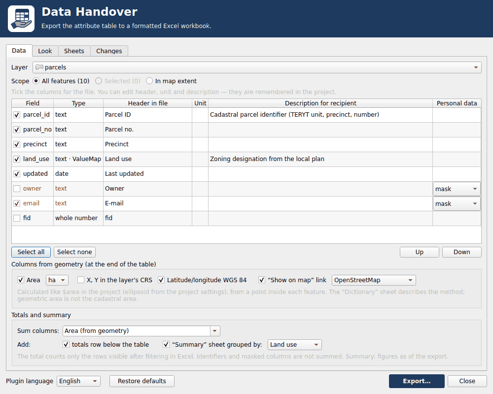
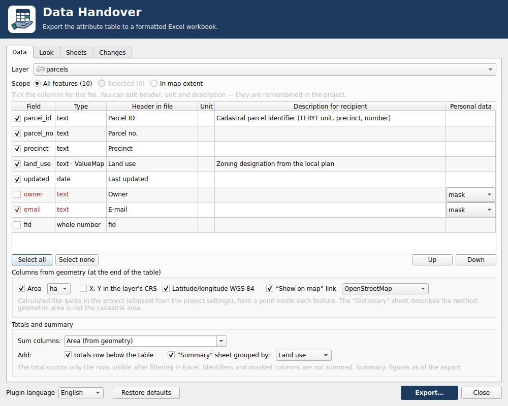
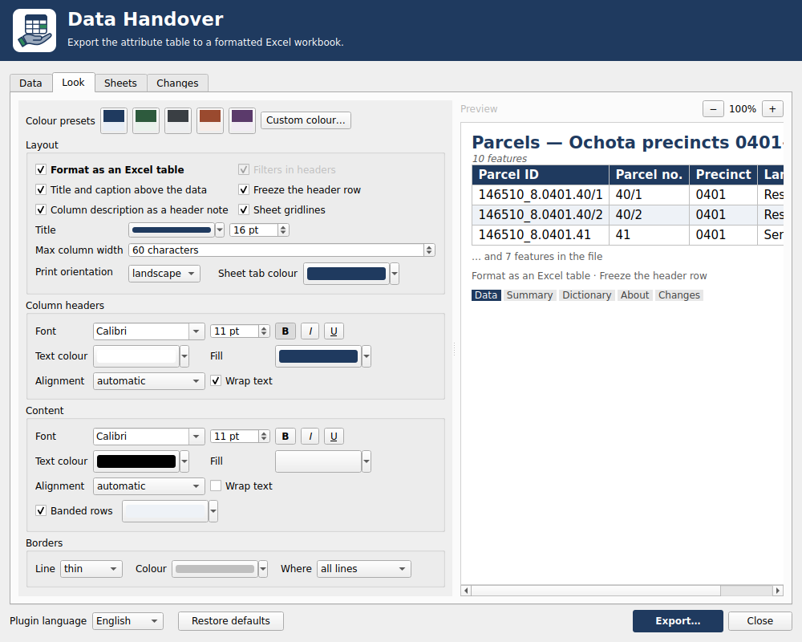
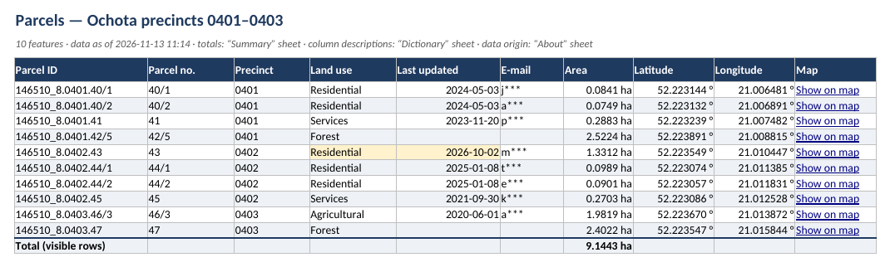
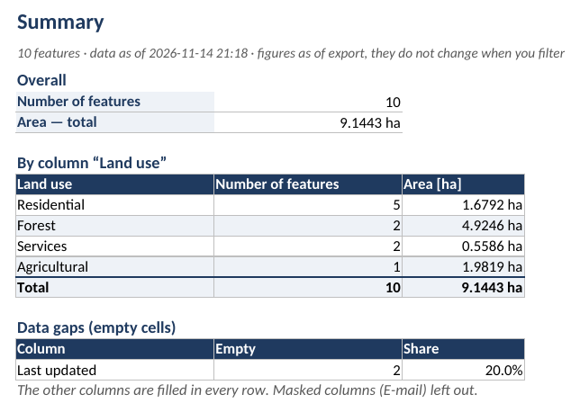
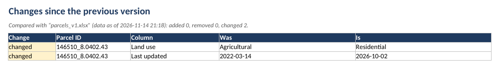
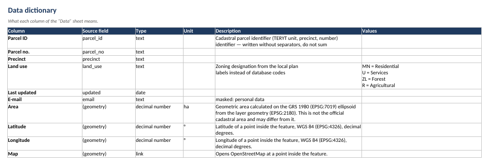
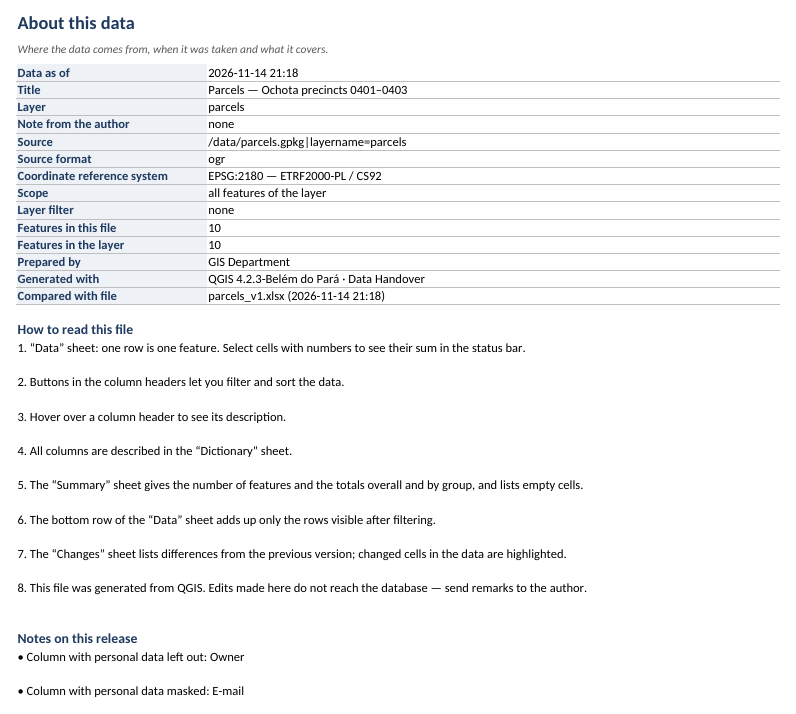

# Data Handover — QGIS plugin

**English** · [Polski](README.pl.md)

A QGIS plugin that exports the attribute table of a vector layer to a
formatted Excel workbook — styled the way you choose, with readable
headers and labels instead of codes.



*The window in QGIS 4.2.3 on Linux, then the exported file. Sheet images are
rendered by LibreOffice; Excel also shows the table styles and the header
notes.*

## What you set

| Tab | What it holds |
|---|---|
| **Data** | layer, scope (all / selected / in map extent), columns and their order, header, unit and description of each column (saved in the project), the decision about personal data, columns from geometry (area or length, coordinates, map link) |
| **Look** | Excel table or plain range (with or without filters); separately for headers and content: font, size, colour, bold, italic, underline, fill, alignment, wrapping; banded rows; borders (line, colour, all lines / horizontal only / outline only); title above the data, frozen header, gridlines, description in a header comment, column width, print orientation, tab colour; colour presets and a live preview |
| **Sheets** | title, file language (10 languages, English by default), extra sheets — off by default — with a choice of what goes in |
| **Changes** | comparison with the previous export by a key column |

## What is in the file

| Sheet | What it holds |
|---|---|
| **Data** | the data formatted according to your settings; headers from aliases; labels instead of codes (value map, relations); numbers with a unit that are still numbers; identifiers (e.g. TERYT, parcel numbers) without thousands separators and never summed — text identifiers stay text with their leading zeros; ready to print |
| **Dictionary** (optional) | chosen items for each column: source field, type, unit, description, codes and labels |
| **About** (optional) | chosen items: data as of date, layer, source, coordinate reference system, scope, filter, feature count, author, reading guide, release notes |
| **Changes** (optional) | features added, removed and changed since the previous file, with "was / is" values; changed cells highlighted in the data |

Fields that look like personal data (by field name or by values: Polish
PESEL with a valid checksum, e-mail, phone number, land register number)
are unchecked by default; you can mask them or export them on purpose.
Detection is a hint, not a guarantee of anonymisation. A decision saved in
the project (mask or export as is) stays in force even when a later, smaller
sample no longer reveals the field.

Export runs in the background: QGIS stays usable, and the message bar
shows progress with a **Cancel** button. Cancelling leaves the target
file as it was. With very large lookup layers (Value Relation, Relation
Reference fields) QGIS may pause briefly before the export starts, while
the labels are loaded.

The **Restore defaults** button at the bottom of the window resets the
look, the sheets and the file language (column descriptions saved in the
project stay). The window and the file are available in English, German,
French, Spanish, Portuguese, Polish, Russian, Korean, Japanese and
Simplified Chinese. Pick the window language from the "Plugin language"
list in the footer (English by default); the file language is a separate
choice on the Sheets tab. Column headers and values come from the layer,
so they stay in the language of the data.

## Screenshots

| | |
|---|---|
|  |  |
| **Data** tab: columns, personal data, geometry, totals | **Look** tab with a live preview |

**Data** sheet — masked e-mail, area from geometry, map links, changed cells
highlighted, totals row:



| | |
|---|---|
|  |  |
| **Summary**: totals, breakdown by land use, missing data | **Changes** since the previous export |
|  |  |
| **Dictionary**: what each column means | **About**: source, CRS, scope, reading guide |

## Columns from geometry

Under the field list you can add columns calculated from each feature's
geometry; they go at the end of the Data sheet and are off by default.
The choice is saved with the layer in the project.

| Column | Layers | Unit |
|---|---|---|
| Area | polygon | ha (4 decimals) or m² (2 decimals) |
| Length | line | m (2 decimals) or km (3 decimals) |
| X, Y | any with geometry | units of the layer CRS |
| Latitude, longitude | any with geometry | WGS 84 decimal degrees (6 decimals) |
| Map | any with geometry | "Show on map" hyperlink to OpenStreetMap or Geoportal (Poland) |

- Area and length are calculated like `$area` and `$length` in the project:
  on the ellipsoid from the project properties. Without one, the ellipsoid
  of the layer CRS is used. A projected CRS without any ellipsoid is
  measured on its plane; a geographic one is skipped with a note.
- This is **geometric** area, not the official cadastral area, and it may
  differ from it. The column description (Dictionary sheet and header
  comment) says so.
- Coordinates, latitude/longitude and the link use a point inside the
  feature (`pointOnSurface`), not the centroid, which can fall outside an
  L-shaped parcel. X is the easting and Y the northing, as in QGIS (Polish
  surveying uses the opposite naming; the description says so).
- Excel accepts at most 65,530 hyperlinks per sheet; above that the map
  column is left out with a note.
- The Geoportal link uses the `mapview` URL parameter, which Geoportal sets
  itself but does not document; it may change.
- The Changes sheet compares area and coordinates like any other column;
  the map link is not compared.

## Totals row and Summary sheet

In the **Data** tab, the group **Totals and summary** adds two things; both
are off by default. The settings are saved with the layer in the project and
the Processing algorithm reads them too.

- **Totals row** below the Data table: `SUBTOTAL(109, …)`, so it adds only the
  rows left visible by a filter in Excel. It sits inside the Excel table but
  outside the filter range.
- **Summary** sheet: the number of features and the sums, a breakdown by one
  column (count and sums per group, a row for empty values) and the missing
  data per column. These are the figures from the moment of export; a filter
  in Excel does not change them.

What is summed: decimal fields and the area or length from geometry by
default; integer fields only if you tick them in "Sum columns". Identifiers,
masked columns and columns with a value map are never summed. Masked columns
are not offered for the breakdown either. Integer values from 10^15 up are
written as text (Excel would lose digits), so a column containing them is not
summed; a note in the About sheet says so.

- Area and length from geometry are sums of the values rounded as shown in
  the column. They can differ from `aggregate(sum, $area)` by at most n × half
  a unit of the last decimal place (n is the number of features).
- An integer field whose values are all between 1000 and 2100, with no unit
  and not an identifier, is taken for a year and shown without a thousands
  separator (2019, not 2,019); the window preview does the same.

## Processing, batch mode and `qgis_process`

The same export is available as a Processing algorithm, **Data Handover →
Hand over data (XLSX)** (`dataHandover:package`): in the Processing
Toolbox, in batch mode, in graphical models and from the command line.
It produces the same file as the window, except that the title is always
the layer name and the author's note is not added (both are set only in
the window and are not saved). Columns, headers, units,
descriptions, column order, personal data choices and the key column come
from the layer settings the window saved in the project (also the
columns from geometry; the ellipsoid comes from the project or the
`--ELLIPSOID` option); the look, extra
sheets, author and file language come from the window's saved settings.
Parameters: layer, selected features only, file language and colour preset
(both "As in the plugin window" by default), previous file and key column
(for the Changes sheet; an empty key means the key saved in the window).

```bash
qgis_process plugins enable data_handover
qgis_process help dataHandover:package      # parameters and their values
qgis_process run dataHandover:package --PROJECT_PATH=project.qgz -- \
    INPUT=parcels OUTPUT=/data/parcels.xlsx
```

Two exports writing the same file at the same time are not blocked: the
one that finishes last wins (the file is never left half-written), so give
each run its own output path.

`qgis_process` reads the settings of the QGIS user profile, so run it as
the same system user who set up the window. Without that profile the
default look applies; columns still come from the project.

The window saves the layer settings (columns, headers, units, descriptions,
column order, personal data decisions, key column, columns from geometry)
when you export, and when you switch the plugin language. Closing the
window without exporting discards those changes, so the algorithm keeps
using the settings of the last export from the window. Save the project
afterwards — that is where the layer settings live.

## Requirements and installation

- QGIS 3.40–3.44 or 4.x (tested: 3.40, 3.44.15, 4.2.3).
- The **openpyxl** Python library — included in the QGIS standalone
  installer for Windows; in OSGeo4W add the `python3-openpyxl` package, on
  Linux install `python3-openpyxl`. Without it the plugin shows
  installation instructions.

Install from a file: `scripts/package.sh` builds
`build/data_handover-<version>.zip`; in QGIS: *Plugins → Manage and Install
Plugins → Install from ZIP*. The plugin appears on the toolbar, in the
*Plugins* menu and in the context menu of a vector layer.

## Development

```bash
uvx ruff check .
uv run --no-project --python 3.12 --with mypy --with openpyxl --with types-openpyxl mypy data_handover/core
uv run --no-project --python 3.12 --with pytest --with openpyxl pytest -q
scripts/qgis-test.sh 4.2.3          # test in real QGIS (Docker); CI also runs 3.40 and 3.44.15
scripts/render-xlsx.sh build/przyklad_qgis4.2.3.xlsx   # sheet screenshots (LibreOffice)
scripts/readme-media.sh             # screenshots and animation in screenshots/
```

Changes between versions: [`CHANGELOG.md`](CHANGELOG.md).

## Author

Krzysztof Cichocki — [github.com/kr-ci](https://github.com/kr-ci)

© 2026 Krzysztof Cichocki. License: GPL-2.0-or-later ([`LICENSE`](LICENSE)).
