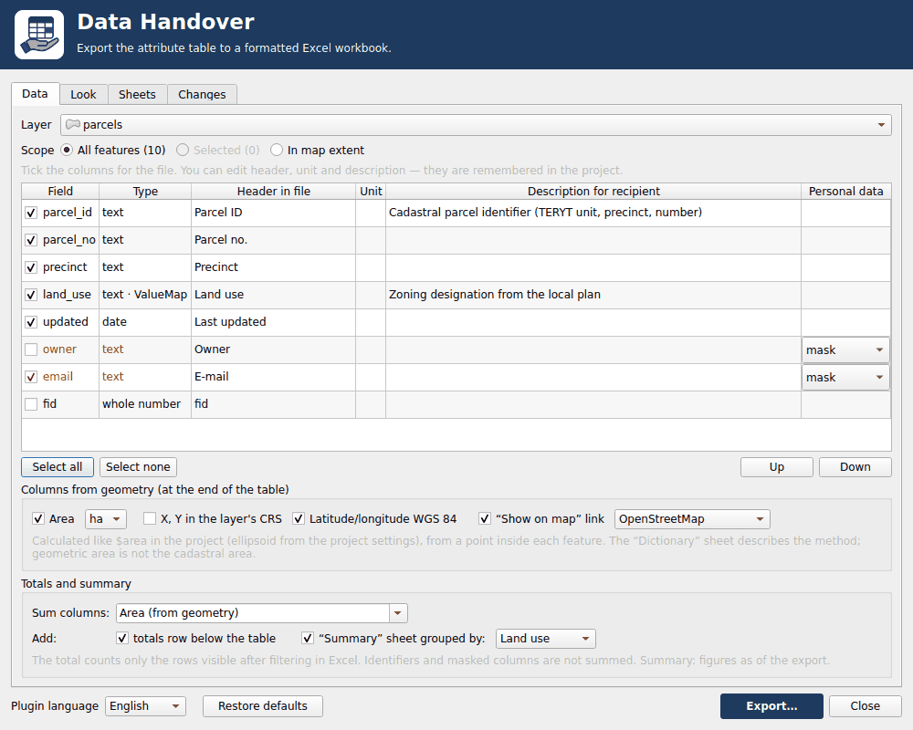
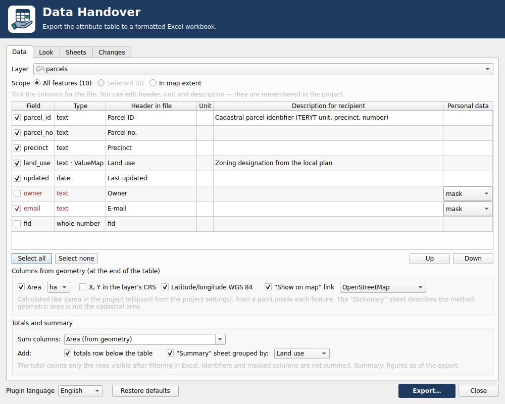
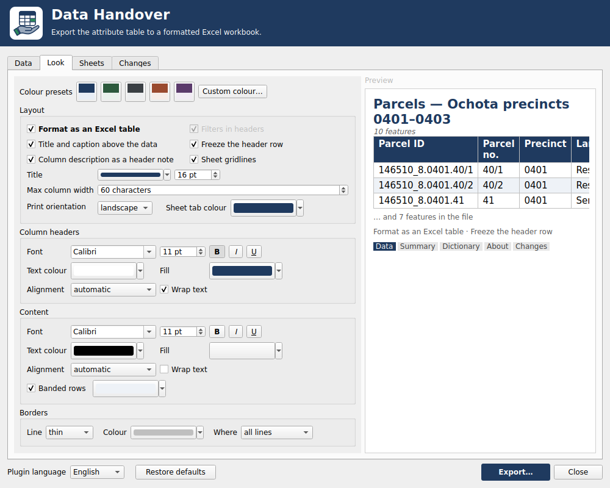
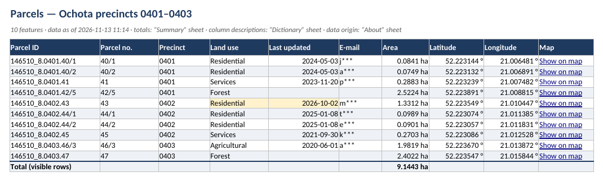
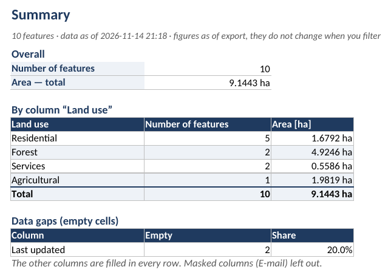
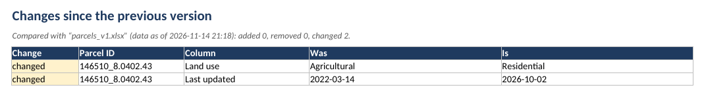
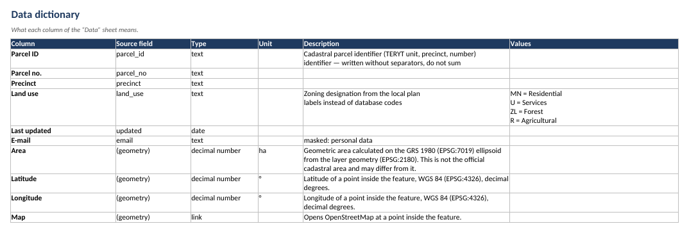
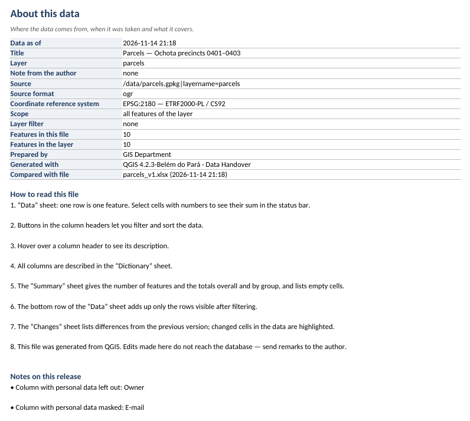

# Data Handover — wtyczka QGIS

[English](README.md) · **Polski**

Wtyczka QGIS, która eksportuje tabelę atrybutów warstwy wektorowej do
sformatowanego pliku Excela — z wyglądem ustawionym przez Ciebie, czytelnymi
nagłówkami i etykietami zamiast kodów.



*Okno w QGIS 4.2.3 na Linuksie (po angielsku), potem wyeksportowany plik.
Arkusze wyrenderował LibreOffice; Excel pokazuje dodatkowo style tabeli
i dymki z opisem kolumn.*

## Co ustawiasz

| Zakładka | Co zawiera |
|---|---|
| **Dane** | warstwa, zakres (wszystkie / zaznaczone / w zasięgu mapy), kolumny i ich kolejność, nagłówek, jednostka i opis kolumny (zapamiętywane w projekcie), decyzja o danych osobowych, kolumny z geometrii (powierzchnia albo długość, współrzędne, link do mapy) |
| **Wygląd** | tabela Excela albo zwykły zakres (z filtrami lub bez); osobno dla nagłówków i zawartości: czcionka, rozmiar, kolor, pogrubienie, kursywa, podkreślenie, tło, wyrównanie, zawijanie; pasy co drugi wiersz; obramowanie (linia, kolor, wszystkie linie / tylko poziome / tylko obrys); tytuł nad danymi, zamrożony nagłówek, siatka, opis w dymku nagłówka, szerokość kolumn, orientacja wydruku, kolor karty; gotowe kolorystyki i podgląd na żywo |
| **Arkusze** | tytuł, język pliku (10 języków, domyślnie angielski), arkusze dodatkowe — domyślnie wyłączone — z wyborem zawartości |
| **Zmiany** | porównanie z poprzednim eksportem według kolumny-klucza |

## Co jest w pliku

| Arkusz | Co zawiera |
|---|---|
| **Dane** | dane sformatowane według ustawień; nagłówki z aliasów; etykiety zamiast kodów (value map, relacje); liczby z jednostką, które dalej są liczbami; identyfikatory (TERYT, nr działki) bez separatorów tysięcy i bez sumowania — tekstowe zostają tekstem z zerami wiodącymi; gotowe do wydruku |
| **Słownik** (opcja) | wybrane pozycje dla każdej kolumny: pole źródłowe, typ, jednostka, opis, kody i etykiety |
| **Metryka** (opcja) | wybrane pozycje: stan danych na dzień, warstwa, źródło, układ współrzędnych, zakres, filtr, liczba obiektów, autor, instrukcja czytania, uwagi do wydania |
| **Zmiany** (opcja) | obiekty dodane, usunięte i zmienione względem poprzedniego pliku, z wartościami „było / jest”; zmienione komórki podświetlone w danych |

Pola wyglądające na dane osobowe (nazwa pola albo wartości: PESEL z sumą
kontrolną, e-mail, telefon, numer księgi wieczystej) są domyślnie
odznaczone; można je zamaskować albo świadomie wyeksportować. Wykrywanie to
podpowiedź, nie gwarancja anonimizacji. Decyzja zapisana w projekcie
(maskować albo eksportować jawnie) obowiązuje także wtedy, gdy późniejsza,
mniejsza próbka nie wykrywa już pola.

Eksport działa w tle: z QGIS można dalej korzystać, a pasek komunikatów
pokazuje postęp z przyciskiem **Anuluj**. Anulowanie zostawia plik
docelowy bez zmian. Przy bardzo dużych warstwach słownikowych (pola Value
Relation, Relation Reference) QGIS może chwilę stać przed startem eksportu,
gdy wczytuje etykiety.

Przycisk **Przywróć domyślne** na dole okna zeruje wygląd, arkusze i język
pliku (opisy kolumn zapisane w projekcie zostają). Okno i plik są dostępne
po angielsku, niemiecku, francusku, hiszpańsku, portugalsku, polsku,
rosyjsku, koreańsku, japońsku i chińsku. Język okna wybierasz na liście
„Język wtyczki” w stopce (domyślnie angielski), język treści pliku —
osobno w zakładce Arkusze. Nagłówki i wartości kolumn pochodzą z warstwy,
więc zostają w języku danych.

## Zrzuty ekranu

Zrzuty pokazują okno i plik po angielsku; po polsku wyglądają tak samo.

| | |
|---|---|
|  |  |
| Zakładka **Dane**: kolumny, dane osobowe, geometria, sumy | Zakładka **Wygląd** z podglądem na żywo |

Arkusz **Dane** — zamaskowany e-mail, powierzchnia z geometrii, linki do
mapy, podświetlone zmienione komórki, wiersz sum:



| | |
|---|---|
|  |  |
| **Podsumowanie**: sumy, podział według przeznaczenia, braki danych | **Zmiany** od poprzedniego eksportu |
|  |  |
| **Słownik**: co znaczy każda kolumna | **Metryka**: źródło, układ, zakres, jak czytać plik |

## Kolumny z geometrii

Pod listą pól można dodać kolumny liczone z geometrii obiektu; trafiają na
koniec arkusza Dane i są domyślnie wyłączone. Wybór zapisuje się przy
warstwie w projekcie.

| Kolumna | Warstwy | Jednostka |
|---|---|---|
| Powierzchnia | poligonowe | ha (4 miejsca po przecinku) albo m² (2 miejsca) |
| Długość | liniowe | m (2 miejsca) albo km (3 miejsca) |
| X, Y | każda z geometrią | jednostki układu warstwy |
| Szerokość, długość geograficzna | każda z geometrią | stopnie dziesiętne WGS 84 (6 miejsc) |
| Mapa | każda z geometrią | hiperłącze „Pokaż na mapie” do OpenStreetMap albo Geoportalu |

- Powierzchnię i długość liczymy jak `$area` i `$length` w projekcie: na
  elipsoidzie z właściwości projektu. Bez niej — na elipsoidzie układu
  warstwy. Układ odwzorowany bez żadnej elipsoidy mierzymy na jego
  płaszczyźnie; geograficzny pomijamy z uwagą.
- To powierzchnia **geometryczna**, nie ewidencyjna, i może się od niej
  różnić. Mówi to opis kolumny (arkusz Słownik i dymek nagłówka).
- Współrzędne, szerokość/długość i link liczymy z punktu leżącego wewnątrz
  obiektu (`pointOnSurface`), nie z centroidu, który przy działce
  w kształcie „L” może wypaść poza nią. X to współrzędna wschodnia, Y —
  północna, jak w QGIS (w polskiej geodezji odwrotnie; opis kolumny to
  mówi).
- Excel przyjmuje najwyżej 65 530 hiperłączy w arkuszu; powyżej kolumna
  z linkiem jest pomijana z uwagą.
- Link do Geoportalu używa parametru adresu `mapview`, który Geoportal sam
  ustawia, ale nie opisuje w dokumentacji — może się zmienić.
- Arkusz Zmiany porównuje powierzchnię i współrzędne jak każdą kolumnę;
  linku nie porównuje.

## Wiersz sum i arkusz Podsumowanie

W zakładce **Dane** grupa **Sumy i podsumowanie** dodaje dwie rzeczy; obie są
domyślnie wyłączone. Ustawienia zapisują się przy warstwie w projekcie,
a algorytm Processing też je czyta.

- **Wiersz sum** pod tabelą Dane: `SUBTOTAL(109, …)`, więc dodaje tylko
  wiersze, które zostają widoczne po filtrze w Excelu. Leży w tabeli Excela,
  ale poza zakresem filtra.
- Arkusz **Podsumowanie**: liczba obiektów i sumy, podział według jednej
  kolumny (liczba i sumy na grupę, wiersz dla pustych wartości) oraz braki
  danych w kolumnach. To liczby z chwili eksportu; filtr w Excelu ich nie
  zmienia.

Co jest sumowane: domyślnie pola dziesiętne oraz powierzchnia lub długość
z geometrii; pola całkowite tylko po ręcznym zaznaczeniu w „Sumuj kolumny”.
Identyfikatorów, kolumn maskowanych i kolumn z value map nie sumujemy nigdy.
Kolumn maskowanych nie ma też na liście podziału. Liczby całkowite od 10^15
wzwyż zapisujemy jako tekst (Excel zgubiłby cyfry), więc kolumny, która je
zawiera, nie sumujemy; mówi o tym uwaga w „Metryce”.

- Powierzchnia i długość z geometrii to sumy wartości zaokrąglonych tak, jak
  w kolumnie. Mogą się różnić od `aggregate(sum, $area)` najwyżej o n × pół
  jednostki ostatniego miejsca po przecinku (n to liczba obiektów).
- Pole całkowite, w którym wszystkie wartości mieszczą się w 1000–2100, bez
  jednostki i nie będące identyfikatorem, uznajemy za rok i pokazujemy bez
  separatora tysięcy (2019, nie 2 019); podgląd w oknie robi tak samo.

## Processing, tryb wsadowy i `qgis_process`

Ten sam eksport jest dostępny jako algorytm Processing **Data Handover →
Przekaż dane (XLSX)** (`dataHandover:package`): w Przyborniku Processing,
w trybie wsadowym, w modelu graficznym i z wiersza poleceń. Daje ten sam
plik co okno, z tym że tytułem jest zawsze nazwa warstwy, a uwagi autora
algorytm nie dodaje (oba ustawia się tylko w oknie i nie są zapisywane).
Kolumny, nagłówki, jednostki, opisy, kolejność kolumn,
decyzje o danych osobowych i kolumnę klucza bierze z ustawień warstwy,
które okno zapisało w projekcie (także kolumny z geometrii; elipsoidę —
z projektu albo z opcji `--ELLIPSOID`); wygląd, arkusze dodatkowe, autora i język
pliku — z zapisanych ustawień okna. Parametry: warstwa, tylko zaznaczone
obiekty, język pliku i gotowa kolorystyka (domyślnie „Jak w oknie
wtyczki”), poprzedni plik i kolumna klucza (do arkusza Zmiany; pusty klucz
oznacza klucz zapisany w oknie).

```bash
qgis_process plugins enable data_handover
qgis_process help dataHandover:package      # parametry i ich wartości
qgis_process run dataHandover:package --PROJECT_PATH=projekt.qgz -- \
    INPUT=dzialki OUTPUT=/dane/dzialki.xlsx
```

Dwa eksporty zapisujące jednocześnie ten sam plik nie są blokowane:
zostaje wynik tego, który skończy później (plik nigdy nie zostaje
zapisany do połowy), więc każdemu uruchomieniu daj własną ścieżkę.

`qgis_process` czyta ustawienia profilu użytkownika QGIS, więc uruchamiaj
go jako ten sam użytkownik systemu, który ustawiał okno. Bez tego profilu
obowiązuje domyślny wygląd; kolumny i tak pochodzą z projektu.

Okno zapisuje ustawienia warstwy (kolumny, nagłówki, jednostki, opisy,
kolejność kolumn, decyzje o danych osobowych, kolumnę klucza, kolumny
z geometrii) przy eksporcie i przy zmianie języka wtyczki. Zamknięcie okna
bez eksportu porzuca te zmiany, więc algorytm dalej używa ustawień
z ostatniego eksportu z okna. Potem zapisz projekt — to w nim są
ustawienia warstwy.

## Wymagania i instalacja

- QGIS 3.40–3.44 albo 4.x (sprawdzone: 3.40, 3.44.15, 4.2.3).
- Nic więcej nie trzeba instalować: wtyczka zapisuje XLSX biblioteką
  **openpyxl** z QGIS, jeśli jest (ma ją instalator QGIS dla Windows),
  a w przeciwnym razie kopią dołączoną do wtyczki (openpyxl 3.1.5
  i et_xmlfile 2.0.0, licencja MIT, w `data_handover/ext`).

Instalacja z pliku: pobierz `data_handover-<wersja>.zip` z
[Releases](https://github.com/kr-ci/qgis-data-handover/releases) (albo zbuduj
go poleceniem `scripts/package.sh`); w QGIS: *Wtyczki → Zarządzaj wtyczkami →
Zainstaluj z pliku ZIP*. Wtyczka pojawia się na pasku narzędzi, w menu
*Wtyczki* i w menu kontekstowym warstwy wektorowej.

## Rozwój

```bash
uvx ruff check .
uv run --no-project --python 3.12 --with mypy --with openpyxl --with types-openpyxl mypy data_handover/core
uv run --no-project --python 3.12 --with pytest --with openpyxl pytest -q
scripts/qgis-test.sh 4.2.3          # test w prawdziwym QGIS (Docker); CI także 3.40 i 3.44.15
scripts/render-xlsx.sh build/przyklad_qgis4.2.3.xlsx   # zrzuty arkuszy (LibreOffice)
scripts/readme-media.sh             # zrzuty i animacja do screenshots/
```

Zmiany między wersjami: [`CHANGELOG.md`](CHANGELOG.md) (po angielsku).

## Autor

Krzysztof Cichocki — [github.com/kr-ci](https://github.com/kr-ci)

© 2026 Krzysztof Cichocki. Licencja: GPL-2.0-or-later ([`LICENSE`](LICENSE)).
